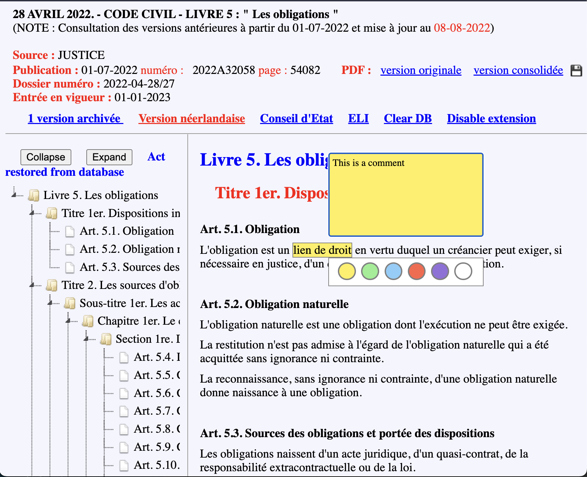
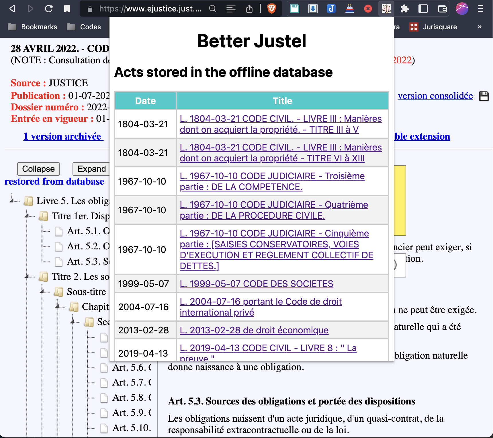

# Better Justel

## Concept

This browser extension (available for [Chrome](https://chrome.google.com/webstore/detail/better-justel/jjknlnihcjeefjgdacaanbiedamibimp) and [Firefox](https://addons.mozilla.org/fr/firefox/addon/better-justel/)) takes the information publicly available on [Justel](https://www.ejustice.just.fgov.be/cgi_loi/rech.pl?language=fr), the Belgian database of consolidated legislation, and displays it in a more user-friendly experience.

IMPORTANCE NOTICE: If you are using the Firefox extension, the first time you will surf to Justel website, a blue dot will appear on the icon of the extension. You must right-click on the extension icon and grant it permission to always run on www.ejustice.fgov.be. Otherwise, the extension will not work.

## Features

- On the search page, three buttons allow to easily select statutes, royal decrees or treaties as the nature of the act to be searched. The place on the page of the date of promulgation and the date of publication are swapped, because a search based on the date of promulgation is more common. By default, a search is based on the title of the act rather than its content to narrow down the results.
- On the results page, each link opens the act in a new window by default.
- The page on which each act is displayed is divided in three panes : the upper pane containing general information on the act; the left pane with a table of content; and the right pane displaying the content of the act. Each pane can be resized by hovering the mouse on the dividing line and dragging it.
- In the info pane, the icon of a disk allows to download and automatically name the consolidated version of the act in PDF. The link "Clear storage" removes the act and its downloaded archives from the offline database, while preserving highlights. The link "Original Justel" shows the original page without the extension.
- The left pane displays the internal structure of the acte based on its headings (Title, Chapter, Section, etc.) and allows to jump immediately to the relevant part of the act by clicking on an article. The table of content can be fully collapsed or expanded with two different buttons.
- In the right pane, the hierarchical level of each heading is reflected by appropriate styling. The content of each article is also analysed. The text is indented to make appear more clearly the internal structure (§, 1°, a), hyphen, etc.). The number of each article is shown in bold. Subparagraphs (alénas) are also automatically numbered in the margin of the article.
- Modified and repealed articles have a backwards clock to the left of the bookmark star, visible when hovering or focusing the article. Click it to open a margin with the entry-into-force date (DD/MM/YYYY) and a version slider. Small tick marks show every available slider position, and the version count is visible beneath it. Hover over the slider to preview dates; move it to display an archived version. The date is centred between the clock and the bookmark star, which also has a tooltip. Earlier versions use the same bold numbering and indentation as the latest text, with a grey colour and border. The margin controls remain visible while scrolling through the article. The "Archived version" label opens the selected archive in a new tab. Click the clock again to close the history and restore the latest text.
- Article history downloads start only when the clock is clicked, which spins until the relevant archives are ready. The latest archive's modification sheet identifies which full snapshots are needed for that article, including modifications hidden by a later repeal. Insertion references also identify the pre-insertion snapshot when the modification sheet omits the new article; that snapshot explicitly indicates its absence. Downloaded archives are stored locally and shared between articles of the same act. Cached versions work offline; a newer act refreshes the archive index and reuses previously downloaded snapshots. Both "Clear storage" in the information pane and the popup's remove button clear the act's archives too.
- Highlights and annotations remain attached to the latest text. Archived text can be selected and copied, but cannot be highlighted or annotated. Existing highlights return when the latest version is selected; case-law blocks are hidden while an archived version is displayed.
- When text is selected within an article in the right page, a popup window appears and allows to highlight the text (in yellow, green, blue or red) or to underline it (in violet). To edit an existing highlight, click on it : the color of it can be changed by clicking on another color, or deleted by clicking on the white circle. A comment can also be inserted. The popup window can be closed by clicking elsewhere in the right pane. When a comment is added to highlighted text, this text is displayed in italic.
- Highlights are stored in the local storage of the browser and are restored the next time the same act is displayed. Saved highlights can be managed with the commands available in the popup window shown when clicking on the icon of the extension. They can be exported in JSON format and imported again by pasting the content of the JSON file in the relevant input box. A daily backup to Dropbox can also be set up (access is limited to the app folder in Dropbox, no access to the rest of the Dropbox is granted).
- Acts displayed are automatically stored in the browser local storage. The optional "Load stored acts immediately" setting opens a stored act without waiting for Justel, then checks for updates once per day in the background and reloads the online page only when a newer version exists. Stored acts can also be consulted offline: when no internet access is available, a user browsing to the ELI URL of a stored act will automatically be redirected to the offline version of it. The online or offline character of the text displayed is mentioned on top of the left pane. The original ELI URL can be copied from the info pane. The list of stored acts can also be consulted by clicking on the icon of the extension (they are listed in chronological order). Highlights are also displayed and are editable when in offline mode.
- Case law abstracts, downloaded from [Juportal Crawaler database](https://github.com/rafjaf/juportal_crawler/tree/main/data), are displayed under each article. Please note that these abstracts are in no way exhaustive, that important case law may be missing, that it may be misclassified or outdated and that it does not in any way replace a systematic research on Juportal and other databases. Never rely on this information, especially for professional use, without veryfing it personnally. Display of case law is experimental and is currently only open to beta testers.

## Terms and conditions

The use of this browser extension is governed by the [GNU General Public License](LICENSE). This program is free software: you can redistribute it and/or modify it under the terms of the GNU General Public License as published by the Free Software Foundation, either version 3 of the License, or (at your option) any later version.

This program is distributed in the hope that it will be useful, but WITHOUT ANY WARRANTY; without even the implied warranty of MERCHANTABILITY or FITNESS FOR A PARTICULAR PURPOSE. See the GNU General Public License for more details.

Additionnally, the use of this browser extension is governed by Belgian law and any dispute pertaining to the validity, interpretation, performance or extinction of the license agreement, as well as more generally any dispute in connection with this browser extension, will be exclusively submitted to the courts having their seat in Nivelles (Belgium).

## Known bugs and limitations

- For the time being, the extension only works with the French version of Justel, to the exclusion of the Dutch version.
- The HTML of some acts available on Justel is faulty and cannot therefore be displayed correctly.
- Article history is limited to snapshots available in Justel and listed in its archive modification sheet. Separate commencement dates within one amendment do not necessarily have separate snapshots. The first version uses the act's general commencement date unless the article has its own amendment reference; unavailable dates are shown as "Date unknown".
- This extension is still under development, has been vibe-coded with the help of AI and may therefore contain bugs or errors. Do not rely on it, especially for professionnal use, and always double-check the content of an act in official sources.
- Do not hesitate to report any problem or suggested improvement, and/or to contribute to the source code.

## Credits

This extension was written by Rafaël Jafferali. 

This extension was inspired by the very thorough userscript written by Naja Melan <https://userscripts-mirror.org/scripts/show/11725>.

It makes use of the following open source libraries :

- dom-anchor-text-position 5.0.0 &lt;https://www.npmjs.com/package/dom-anchor-text-position&gt; and dom-anchor-text-quote 4.0.2 &lt;https://www.npmjs.com/package/dom-anchor-text-quote&gt;, packaged by judell &lt;https://github.com/judell/TextQuoteAndPosition&gt;
- download.js 4.2 &lt;https://github.com/rndme/download&gt;
- Dropbox SDK &lt;https://github.com/dropbox/dropbox-sdk-js&gt;
- jquery 3.6.1 &lt;https://jquery.com/&gt;
- jquery UI 1.21.1 &lt;https://jqueryui.com/&gt;
- jquery resizable plugin 0.35 &lt;https://github.com/RickStrahl/jquery-resizable&gt;
- jsTree 3.3.12 &lt;https://www.jstree.com/&gt;

## Release history
- Version 0.1.2022.1116 : first version published online.
- Version 0.1.2022.1204 : added auto-numbering of subparagraphs (alinéas).
- Version 0.1.2023.0506 : added autofocus to search input box in popup window
- Version 0.1.2023.0507 : clear button in popup window also deletes highlights; confirmation added before clearing; change toggle Dropbox to enable/disable Dropbox; added overflow to annotations
- Version 0.1.2023.0513 : added compatibility to Firefox
- Version 0.1.2023.0514 : visibility of subparagraphs (alinéas) numbering only visible when hovering with the mouse over the relevant article; display in the toc the number of last article even though it is not properly encoded in the HTML
- Version 0.1.2023.0530 : improves indent of articles (includes numbering starting with I., II., etc.)
- Version 0.1.2023.0601 : improves indent of articles (includes numbering starting with i., ii., etc.)
- Version 0.1.2023.0722 : for some (as yet) unidentified reason, in the Code of Economic Law, some highlights were sometimes saved under an inexistent article, resulting in a bug when trying to restore the highlights for such statute. A work-around has now been found.
- Version 0.1.2023.0909 : URLs inserted in an annotation will be converted to hyperlinks when the annotation is reopened
- Version 0.1.2023.0910 : daily backup of highlights is confirmed in a status message at the bottom of the page
- Version 0.1.2023.0916 : correction of bugs (stylesheet applicable in offline mode)
- Version 0.1.2023.0917 : improved status message when Dropbox backup done
- Version 0.1.2023.1111 : added an ability to bookmark articles and to display a bookmark bar (just click on the star appearing next to each article when hovering the mouse on the article text). The bookmark bar is draggable and can be minimised.
- Version 0.1.2023.1113 : correction of a bug (incompatibility between jquery UI and jquery resizable)
- Version 0.1.2023.1116 : improvement of CSS (position of bookmark star)
- Versoin 0.1.2023.1118 : adds a possibility to remove a bookmark directly from the bookmark bar by clicking on the star next to the bookmark
- Version 0.1.2023.1209 : solves a bug which prevented saving highlights or bookmars pertaining to an article which was not displayed in the TOC because it was collapsed
- Version 0.2.2024.0519 : update to the new version of Justel and multiple improvements and correction of bugs
- Version 0.2.2025.0525 :
	- improved parsing of headings (notably for the Code of Economic Law) : avoid recognising as heading something which looks like a heading (e.g. starting with "partie") but not followed by an ordinal or roman numeral
	- disables extension on page listing acts (generally royal decrees) adopted in execution of an article
- Version 0.3.2026.0214 :
	- fixed parsing of acts containing certain malformed HTML elements (e.g. `<AR>` tags) that caused content to be cut off (e.g. Code de la route)
	- some article titles in upper cases (e.g. "CHAMP D'APPLICATION." for Art. 1) are now shown in the TOC
	- fixed a bug causing articles to be incorrectly displayed as headings (wrong styling) due to an erroneous two-titles-in-one-heading detection when text from abrogated italic sections was parsed
	- improved indentation algorithm: i), v) and x) are no longer incorrectly treated as roman numerals when they are actually letters in alphabetical lists (e.g. law of 18 December 2017, art. 4, 23°)
	- added a button to display the Dutch version of the text in the info pane
	- the extension is now disabled on the Dutch version of Justel (to avoid interfering with it)
	- fixed highlights and bookmarks not working in offline mode (missing jQuery UI dependency in offline page)
	- clicking a bookmark now also expands and scrolls to the relevant article in the TOC
	- fixed intermittent error with bookmark bar draggable functionality
	- extended indentation support for double-letter list items (e.g. aa), bb)) to be indented at the same level as single-letter items (e.g. z))
	- fixed some offline layout differences: added global box-sizing, system font family, and viewport meta tag to match online rendering
	- file system dialog box to import highlights
	- content.js split in several smaller files for better readability
- Version 0.3.2026.0215 : fixing issue https://github.com/rafjaf/BetterJustel/issues/3
- Version 0.4 : implementation of case law abstracts under each article, downloaded from [Juportal Crawaler database](https://github.com/rafjaf/juportal_crawler/tree/main/data)
- Version 0.4.1 : fixed cached/restored acts getting stuck on "Loading ..." in the table of contents when Justel's Content Security Policy blocks jsTree's Blob worker
- Version 0.4.2 :
	- fixed coloured background of articles in the TOC lost when collapsing then expanding the TOC again
	- fixed popup commands not working (Export higlights and Enable Dropbox sync)
	- prettified export highlights
	- highlight annotation popups can now be resized and file:/// URLs are automatically transformed into links
	- implemented Firefox Developer Hub recommendations
- Version 0.5 :
	- optional faster loading of already stored acts (needs to be enable in the settings in the popup window). As a drawback, the browser will be redirected to the Chrome extension page, not the original Justel page (whose URL can be retrieved by clicking on "Copy ELI"). You will need to confirm the grant of webNavigation permission, i.e. access to the browser navigation history (required to interrupt the loading of the page on Justel web server, which is often much slower)
	- improved layout for the information pane at the top of the page
	- improved search on Justel directly from the popup window
	- fixed Art.XV.125/5 ff. CDE being mischaracterized as headings
	- fixed vertical alignement of the bookmark star with the first line of the article
- Version 0.5.1 :
	- implemented new roll number system for the Court of cassation (e.g. 26/CAS/0264 instead of C.26.00264.F). Thanks to [Céline Joisten](https://www.linkedin.com/posts/c%C3%A9line-joisten-32489314a_aviez-vous-remarqu%C3%A9-depuis-le-share-7500121372870832128-Z7f4/) for the useful explanation.
	- fixed characters encoding when a search request is passed from popup window to Justel website
- Version 0.5.2 :
	- fixed links to modifying laws when page was saved offline
	- annotation links are displayed in blue and underlined
	- apostrophes immediately following a letter are converted to typographic apostrophes when copying text, while preserving rich text formatting
	- Collapse, Expand and Jump remain visible when scrolling the table of contents, while the act loading status scrolls with its contents
	- added an Article field with a clear button and a Jump button to move both the table of contents and the text to an article, including when its section is collapsed
	- article title detection checks the pattern across the act to avoid mistaking an isolated paragraph without a final full stop for a title (e.g. Art. 1494 of the Judicial Code), including in already saved pages
	- the Better Justel badge links to the project's GitHub page
- Version 0.6.0 :
	- added article history with a backwards clock, animated margin expansion, entry-into-force dates and a discrete version slider with hover previews
	- downloads only the relevant article archives after consulting the archive modification sheet, including the earlier history of repealed articles
	- caches full archive pages locally for reuse across articles and offline viewing, while refreshing the index when the act changes
	- formats archived articles with the same parser as the latest text, displays them in grey, and preserves current-text highlights and annotations when switching versions
	- supports both numbered amendment footnotes and older inline references with day-first or ISO dates
	- clearing an act from either the information pane or the popup also removes its archives and invalidates pending downloads
	- refined history controls with sticky positioning within the article, a centred date, bookmark tooltips, visible slider ticks and archive links
	- increased the spacing between archived paragraph labels and the vertical border, and narrowed the Article jump field
	- fixed history for inserted articles omitted from the modification sheet, including Art. 6ter of the special law of 8 August 1980
